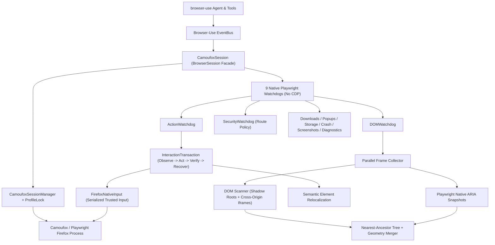

# camoufox-browser-use

**A CDP-free Firefox/Camoufox Playwright backend for [`browser-use`](https://github.com/browser-use/browser-use).**

[](https://www.python.org/downloads/)
[](LICENSE)
[](PARITY.md)
[-purple.svg)](PARITY.md)

`browser-use` is built around Chromium and Chrome DevTools Protocol (CDP) internals (`DOMSnapshot`, `Accessibility.getFullAXTree`, CDP targets, and WebSocket sessions). Firefox and [Camoufox](https://github.com/daijro/camoufox) do not speak CDP, so swapping executables breaks observation, watchdogs, and actions.

`camoufox-browser-use` implements `browser-use`'s public `BrowserSession` and `EventBus` contracts on top of **native Playwright Firefox APIs**—zero CDP sessions, zero emulated DevTools shims, and full drop-in compatibility with `browser-use` agents and tools.

---

## Architecture



---

## 30-Second Quickstart

### 1. Install

```bash
pip install camoufox-browser-use
python -m camoufox fetch
```

Optional Gemini helper (`GeminiChatModel`, `GeminiKeyPoolChatModel`):

```bash
pip install "camoufox-browser-use[gemini]"
```

### 2. Run a `browser-use` Agent on Camoufox

```python
import asyncio
from browser_use.agent.service import Agent
from browser_use.tools.service import Tools
from camoufox_browseruse import open_camoufox_session, register_camoufox_tools


async def main() -> None:
    tools = Tools()
    register_camoufox_tools(tools)

    async with open_camoufox_session(headless=False) as session:
        await session.navigate_to("https://example.com")

        agent = Agent(
            task="Summarize the main heading and link on this page.",
            llm=your_llm,  # Any browser-use compatible LLM
            browser_session=session,
            tools=tools,
        )
        history = await agent.run(max_steps=10)
        print(history.final_result())


if __name__ == "__main__":
    asyncio.run(main())
```

Sessions are ephemeral by default. To persist cookies and local storage across runs (protected by a cross-process `ProfileLock`), pass `user_data_dir`:

```python
async with open_camoufox_session(user_data_dir="./browser-profile") as session:
    ...
```

To point at a specific Firefox/Camoufox binary, pass `executable_path=...` or set `CAMOUFOX_EXECUTABLE_PATH`.

---

## Parity Highlights

Full contract matrix and intentional boundaries live in [PARITY.md](PARITY.md).

| Subsystem | Native Playwright Implementation |
| --- | --- |
| **DOM + Accessibility** | Collects DOM trees and Playwright ARIA snapshots concurrently per frame across cross-origin iframes and recursive open shadow roots; merges by frame-local geometry into a nearest-ancestor tree where only interactive controls receive `[N]` action indices. |
| **9 Native Watchdogs** | `ActionWatchdog`, `DOMWatchdog`, `SecurityWatchdog`, `StorageStateWatchdog`, `DownloadsWatchdog`, `PopupsWatchdog`, `ScreenshotWatchdog`, `CrashWatchdog`, and opt-in `DiagnosticsWatchdog`. Every `browser-use` 0.13.13 request event has one native owner. |
| **Serialized Input Transactions** | `InteractionTransaction` + `FirefoxNativeInput` route clicks, typing, keys, drags, and scrolling through one session action lock with bounded pre-input retries, at-most-once dispatch, delayed controlled-input commit polling, async ARIA activation checks, and semantic relocalization on DOM mutations. |
| **Profile & Lifecycle Safety** | Cross-process `ProfileLock` prevents concurrent persistent-profile corruption; preserves an `about:blank` tab when closing the last tab; replaces tabs whose main thread freezes during `evaluate`; guards CDP calls explicitly with `NoFakeCDPClient`. |
| **Security Policy** | Route-level enforcement of `allowed_domains`, `prohibited_domains`, and `block_ip_addresses` across link clicks, JS navigation, and subframes, with `BrowserErrorEvent` notifications. |
| **Bounded Task Runner** | Optional `BrowserTaskRunner` + `ExperienceLearner` add step/time/token budgets, stagnation detection, adaptive vision, and verified-outcome cross-run memory without altering direct `Agent` usage. |

---

## Benchmarks & Differential Testing

`camoufox-browser-use` ships with a deterministic, LLM-free differential test harness and an observation latency benchmark comparing Camoufox directly against upstream `browser-use` Chromium on identical local HTML fixtures.

### Run the Unified Test Suite

```bash
# Fast unit tests (no browser required)
pytest tests/test_unit_core.py tests/test_evaluation_contracts.py \
       tests/test_launcher.py tests/test_learning.py tests/test_runner.py

# Full deterministic suite (unit + live Camoufox integration, stress, iframe, reliability)
python run_tests.py

# Offline smoke check and runnable agent examples
python test_installation.py
python example_usage.py
python demo_form_fill.py
```

### Run Backend Differential & Performance Benchmarks

```bash
# Deterministic differential parity suite (upstream Chrome vs Camoufox)
# --strict exits non-zero only if upstream passes a capability that Camoufox fails
python -m benchmarks.run_backend_differential --iterations 5 --strict

# Observation latency probe (DOM extraction, screenshot, combined BrowserStateSummary)
python -m benchmarks.run_performance_benchmark --backends camoufox original --iterations 15
```

Baseline validation against `browser-use==0.13.13` (Linux, Python 3.12):
- **0 Camoufox regressions** across the 5-iteration strict backend differential suite (forms, stale-node recovery, open shadow DOM, 3-origin nested iframes, tabs, dialogs, downloads, screenshots, and tool outputs).
- **Bounded failure diagnostics** via opt-in `diagnostics_dir` (writes redacted `event.json`, screenshot, and LLM DOM snapshot per `BrowserErrorEvent`).

---

## Project Layout

```text
camoufox-browser-use/
├── camoufox_browseruse/
│   ├── __init__.py          # Public API (CamoufoxSession, open_camoufox_session, register_camoufox_tools)
│   ├── launcher.py          # Executable resolution, Wayland env prep, cross-process ProfileLock
│   ├── session.py           # BrowserSession-compatible facade
│   ├── session_manager.py   # Browser process, context, tab registry, target IDs, focus ownership
│   ├── interactions.py      # Observe-act-verify-recover InteractionTransaction
│   ├── native_input.py      # Serialized Firefox pointer, keyboard, drag, and scroll delivery
│   ├── dropdowns.py         # Native <select> and owned ARIA listbox enumeration & selection
│   ├── runner.py            # Opt-in BrowserTaskRunner (budgets, stagnation recovery, adaptive vision)
│   ├── learning.py          # Opt-in ExperienceLearner (verified-outcome cross-run memory)
│   ├── helpers.py           # NoFakeCDPClient guard and key helpers
│   ├── compat.py            # Narrow MCP compatibility hooks
│   ├── llm.py               # Optional GeminiChatModel / GeminiKeyPoolChatModel
│   ├── dom/                 # Parallel DOM + ARIA frame collector, serializer, semantic relocalization
│   ├── watchdogs/           # 9 native Playwright watchdogs (no CDP)
│   └── tools/               # Overrides only for upstream tools that require CDP
├── benchmarks/              # Differential contract harness & observation latency probe
├── tests/                   # Offline fixtures, unit tests, stress, 3-origin iframe, reliability suites
├── PARITY.md                # Full browser-use 0.13.13 contract & boundary matrix
├── example_usage.py         # End-to-end runnable offline Agent example
└── demo_form_fill.py        # Multi-step form filling demo
```

---

## Known Boundaries

- Raw `cdp_client*` calls raise explicit `NotImplementedError` via `NoFakeCDPClient`—Camoufox does not expose Chromium CDP.
- Remote/cloud CDP URLs and Chromium browser extensions are unsupported.
- PDF export produces paginated raster PDFs from full-page screenshots (visual rather than selectable vector text).
- Playwright is capped below `1.64.0` (`playwright>=1.50.0,<1.64.0`) for protocol compatibility with current Camoufox builds.

---

## License

MIT License. See [LICENSE](LICENSE).

---

**Built by PullMesh.** Need production browser automation, AI agent workflows, or reliable data pipelines built on Playwright, Camoufox, or n8n? See what we build at [pullmesh.com/services](https://pullmesh.com/services/), or read engineering write-ups on [DEV.to (`anasbuilds997`)](https://dev.to/anasbuilds997).

### Companion Open-Source Repositories

- [`anassk01/playwright-resilient-portal-bot`](https://github.com/anassk01/playwright-resilient-portal-bot) — Resilient Playwright portal automation with retry recovery and read-back export verification
